# Práctica 3 Unity: Movimiento - Físicas 3D

## Autor

Daniel Palenzuela Álvarez (alu0101140469)

## Introducción

En esta práctica se estudia el sistema de física 3D de Unity. En la hoja 1 se comparan, desde el inspector y sin utilizar scripts, distintas configuraciones de `Collider`, `Rigidbody`, masa, fricción y `Is Trigger`. En la hoja 2 se han creado scripts en C# para controlar un personaje, reaccionar a colisiones, detectar zonas, filtrar interacciones por capas, aplicar fuerzas y mover una esfera hacia un objetivo.

# Hoja 1: Situaciones con Rigidbody y Collider

## Preparación de la escena

Se prepara una escena 3D con los objetos `Plane`, `Cube` y `Sphere`, creados desde **GameObject -> 3D Object**. La cámara y el plano mantienen sus valores iniciales. Se configuran las transformaciones indicadas en el enunciado:

| Objeto | Position              | Rotation    | Scale       |
| ------ | --------------------- | ----------- | ----------- |
| Plane  | `(0, 0, 0)`           | `(0, 0, 0)` | `(1, 1, 1)` |
| Cube   | `(0, 0.5, 0)`         | `(0, 0, 0)` | `(1, 1, 1)` |
| Sphere | `(0.64, 1.79, -0.36)` | `(0, 0, 0)` | `(1, 1, 1)` |

## Situación 1: Solo el cubo es físico
El plano no es un objeto físico. El cubo es un objeto físico y la esfera no. En este caso, el plano y la esfera sólo tendrán collider, mientras que el cubo debe tener Rigidbody. 

### Configuración

* **Plane:** conserva su Collider y no tiene Rigidbody.
* **Cube:** conserva su Collider y tiene un Rigidbody dinámico (`Is Kinematic` desactivado).
* **Sphere:** conserva su Collider y no tiene Rigidbody.

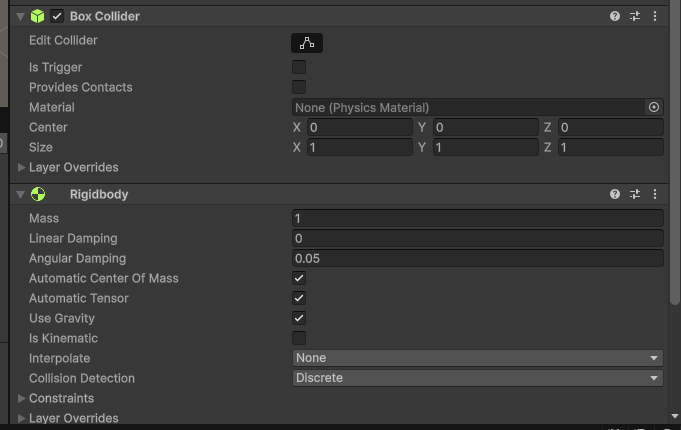

### Comportamiento

El plano actúa como suelo fijo, el cubo ya está colocado con su base aproximadamente en contacto con el plano y la gravedad lo mantiene apoyado en él. La esfera no cae porque no tiene Rigidbody y permanece en la posición inicial. En esta configuración, el motor físico solo integra el movimiento del cubo, un Collider sin Rigidbody no adquiere movimiento físico propio.

**Ejecución:** 
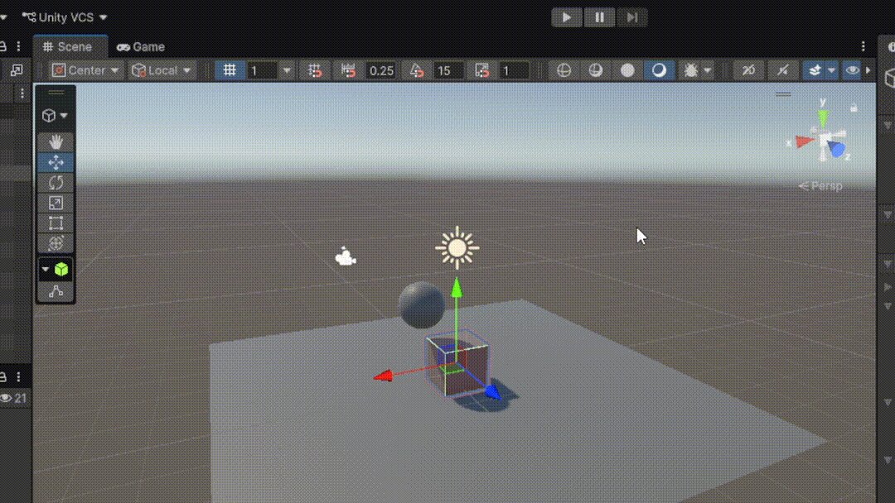

## Situación 2: Cubo y esfera físicos
El plano no es un objeto físico. El cubo es un objeto físico y la esfera también. En este caso, el plano sólo tendrán collider, mientras que el cubo y la esfera deben tener Rigidbody. 

### Configuración

* **Plane:** solo Collider, sin Rigidbody.
* **Cube:** Collider y Rigidbody dinámico.
* **Sphere:** Collider y Rigidbody dinámico.

### Comportamiento

El plano continúa fijo, el cubo y la esfera están controlados por la física y responden a la gravedad. La esfera desciende desde su posición inicial y puede hacer contacto con el cubo, al ser ambos dinámicos, el contacto puede modificar el movimiento de los dos. Después, los objetos quedan apoyados si sus posiciones permiten el equilibrio. La diferencia respecto a la situación 1 es que la esfera ya no es un elemento estático, tiene un Rigidbody propio y puede caer y reaccionar a las colisiones.

**Ejecución:**  
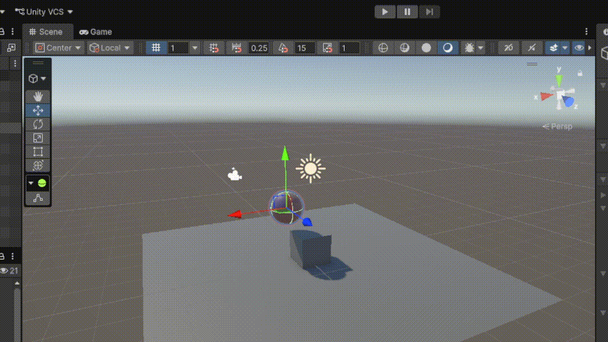

## Situación 3: Esfera cinemática
El plano no es un objeto físico. El cubo es un objeto físico y la esfera es cinemática. En este caso, el plano sólo tendrán collider, mientras que el cubo y la esfera deben tener Rigidbody esta última cinemático. 

### Configuración

* **Plane:** solo Collider, sin Rigidbody.
* **Cube:** Collider y Rigidbody dinámico.
* **Sphere:** Collider y Rigidbody con `Is Kinematic` activado. Se desactiva `Use Gravity` para dejar explícito que no debe caer por gravedad.

### Comportamiento

El plano permanece fijo y el cubo queda apoyado sobre él, la esfera cinemática conserva su posición porque el motor físico no la desplaza mediante fuerzas o gravedad. Con las transformaciones iniciales indicadas, la esfera queda por encima del cubo y existe una separación entre ambos, por lo que no se produce contacto en reposo. Si se aproximaran hasta tocarse, la esfera podría influir en el cubo, pero no sería desplazada como un cuerpo dinámico.
Esta situación muestra que un Rigidbody cinemático no cae por gravedad. Con las posiciones del enunciado no se observa un impacto entre la esfera y el cubo hasta que cambia su posición.

**Ejecución:**  
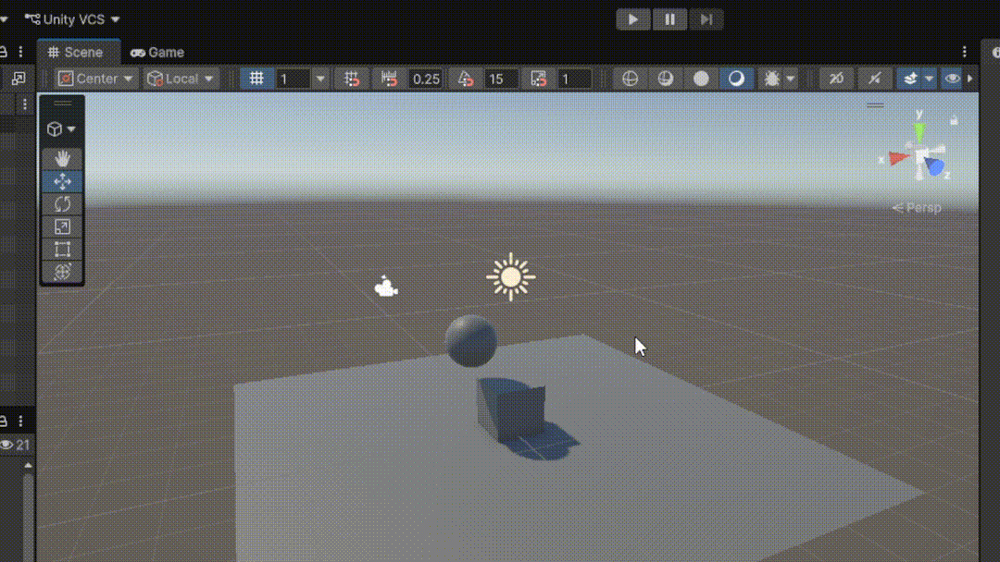

## Situación 4: Plano, cubo y esfera dinámicos
El plano es un objeto físico. El cubo es un objeto físico y la esfera es física. En este caso, todos los objetos deben tener Rigidbody. 

### Configuración

* **Plane:** Collider y Rigidbody dinámico.
* **Cube:** Collider y Rigidbody dinámico.
* **Sphere:** Collider y Rigidbody dinámico.

### Comportamiento

El plano deja de ser un suelo inmóvil, al tener un Rigidbody dinámico, también está sometido a la gravedad y puede desplazarse. Por ello, el conjunto ya no dispone de una superficie fija que sostenga al cubo y a la esfera. Los tres cuerpos se mueven según las fuerzas y los contactos que se produzcan, haciendo que caigan por la gravedad.
La prueba muestra por qué los suelos y paredes que no deben moverse suelen utilizar un Collider sin Rigidbody. Añadir un Rigidbody dinámico a una superficie cambia su función en la escena.

**Ejecución:**  
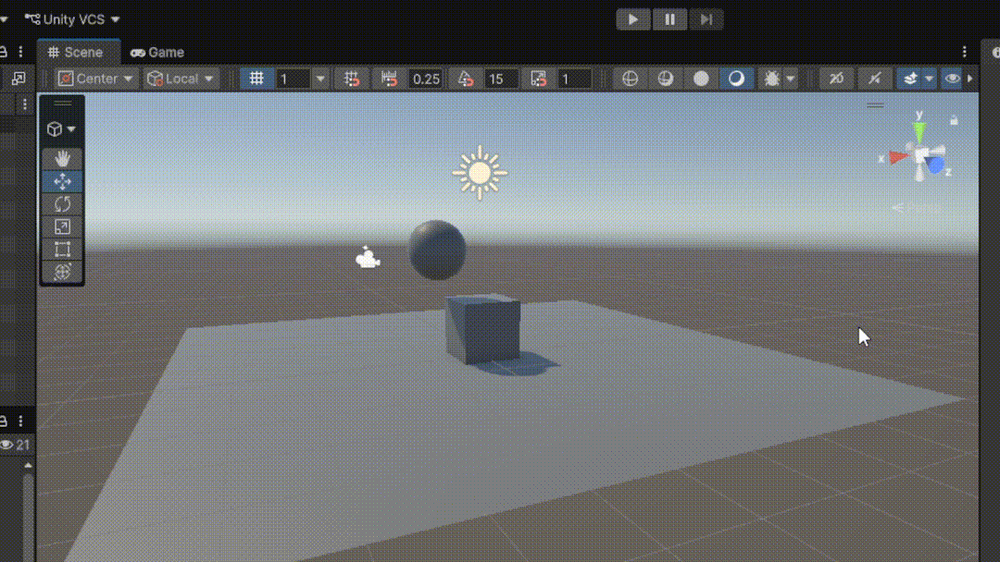

## Situación 5: Plano cinemático y esfera con diez veces más masa
El plano es un objeto cinemático. El cubo es un objeto físico y la esfera es física con 10 veces más masa que el cubo. En este caso, todos los objetos deben tener Rigidbody.

### Configuración

* **Plane:** Collider y Rigidbody con `Is Kinematic` activado.
* **Cube:** Collider y Rigidbody dinámico, masa `1`.
* **Sphere:** Collider y Rigidbody dinámico, masa `10`.

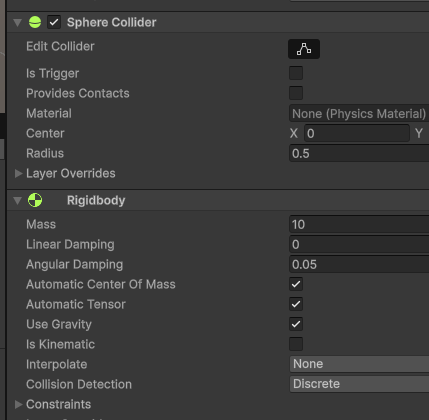

### Comportamiento

El plano se mantiene fijo porque es cinemático, el cubo y la esfera responden a la gravedad. Cuando se produce un impacto entre cuerpos, la esfera de masa `10` presenta una variación de velocidad menor que un cuerpo mucho más ligero ante un impulso comparable. La masa no hace que la esfera caiga diez veces más deprisa, ambos cuerpos experimentan la misma aceleración gravitatoria.

**Ejecución:**  
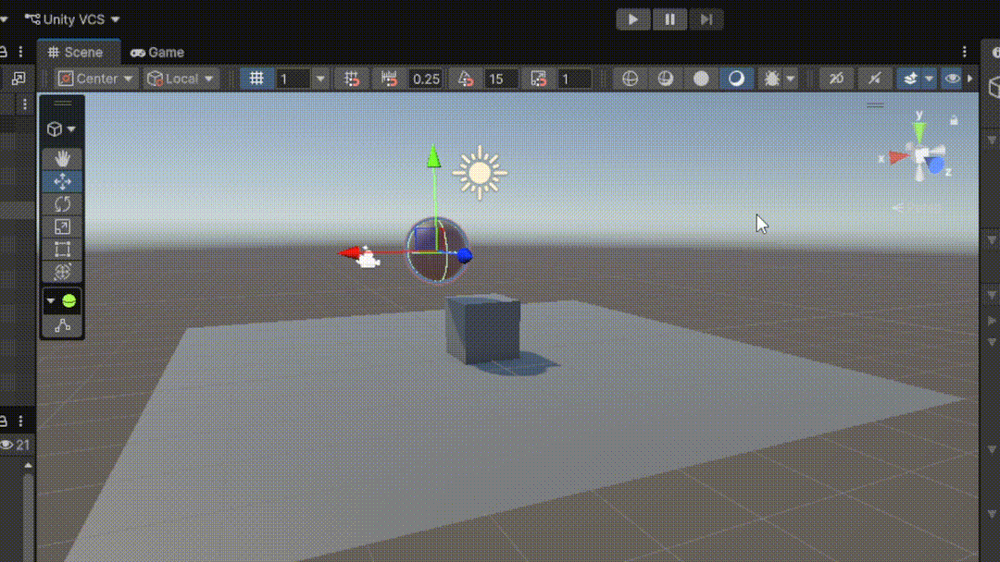

## Situación 6: Plano cinemático y esfera con cien veces más masa
El plano es un objeto cinemático. El cubo es un objeto físico y la esfera es física con 100 veces más masa que el cubo. En este caso, todos los objetos deben tener Rigidbody.

### Configuración

Se mantienen los componentes de la situación 5, pero la masa de la esfera se cambia a `100` y la masa del cubo permanece en `1`.

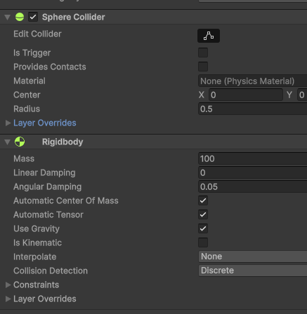

### Comportamiento

El plano continúa inmóvil y ambos objetos dinámicos están sometidos a la gravedad. En los impactos, la diferencia de masa es más notable, el cuerpo de masa `100` suele cambiar menos su velocidad mientras el cuerpo de masa `1` puede experimentar una variación más grande. La diferencia solo puede apreciarse en la respuesta al contacto, donde el golpe es más brusco, la masa no multiplica la aceleración gravitatoria.

**Ejecución:**  
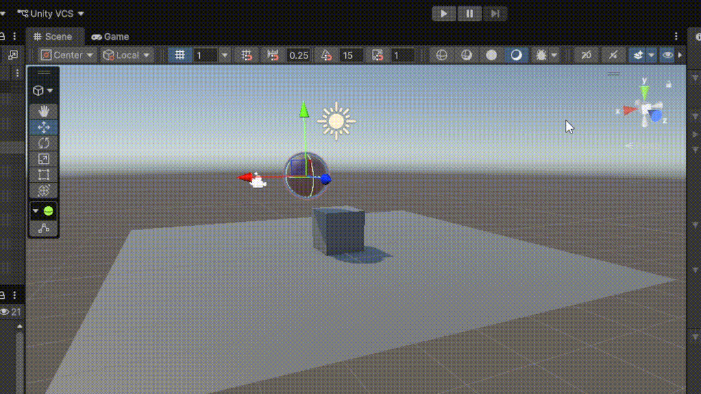

## Situación 7: Plano físico, cubo físico y esfera con fricción
El plano es un objeto físico. El cubo es un objeto físico y la esfera es física con fricción. En este caso, todos los objetos deben tener Rigidbody.

### Configuración

* **Plane:** Collider y Rigidbody dinámico.
* **Cube:** Collider y Rigidbody dinámico.
* **Sphere:** Collider y Rigidbody dinámico.
* Se crea un `Physics Material` y se asigna al Collider de la esfera. Para la prueba añadi por ejemplo fricción estática `0.8`, fricción dinámica `0.8` y `Friction Combine = Maximum`.

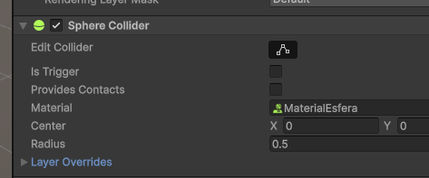
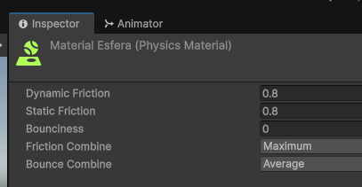

### Comportamiento

El plano también es dinámico, por lo que no permanece fijo como un suelo convencional. El material físico de la esfera incrementa la fricción durante el deslizamiento en los contactos con otros Colliders, siempre según las propiedades de ambos materiales y sus modos de combinación. La fricción se aprecia cuando existe movimiento entre superficies, ya que si no hay deslizamiento, la diferencia puede ser menos visible.

**Ejecución:**  
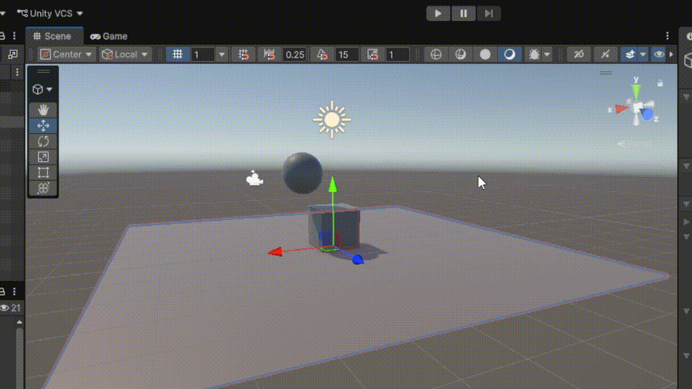

## Situación 8: Plano cinemático, cubo físico y esfera Trigger cinemática
El plano es un objeto cinemático. El cubo es un objeto físico y la esfera no es física y es Trigger. En este caso, todos los objetos deben tener Rigidbody.

### Configuración

* **Plane:** Collider y Rigidbody con `Is Kinematic` activado.
* **Cube:** Collider y Rigidbody dinámico.
* **Sphere:** SphereCollider con `Is Trigger` activado y Rigidbody cinemático (`Is Kinematic` activado y `Use Gravity` desactivado). Se incluye el Rigidbody en la esfera, pero se configura como cinemático y se marca su Collider como Trigger.

### Comportamiento
El plano se mantiene fijo y el cubo queda apoyado sobre él, la esfera permanece en su posición al ser cinemática y no tener gravedad. Su Collider no actúa como una superficie sólida porque tiene `Is Trigger` activado, por tanto, si un cuerpo atraviesa su volumen no será frenado por una colisión sólida.
Con las transformaciones iniciales indicadas, la esfera queda separada del cubo y no se produce solapamiento durante la ejecución.

**Ejecución:**  

## Situación 9: Plano cinemático y esfera dinámica con Trigger
El plano es un objeto cinemático. El cubo es un objeto físico y la esfera es física y es Trigger. En este caso, todos los objetos deben tener Rigidbody.

### Configuración

* **Plane:** Collider y Rigidbody cinemático.
* **Cube:** Collider y Rigidbody dinámico.
* **Sphere:** SphereCollider con `Is Trigger` activado y Rigidbody dinámico, con `Use Gravity` activado.

### Comportamiento

El plano permanece fijo y el cubo interactúa físicamente con él, la esfera está sometida a la gravedad porque su Rigidbody es dinámico, pero el Collider de la esfera no crea contactos sólidos al estar marcado como Trigger. En consecuencia, la esfera puede atravesar el plano y el cubo en lugar de quedar apoyada o rebotar contra ellos. La comparación con la situación 8 permite separar los efectos de `Is Kinematic` y `Is Trigger`, donde la primera propiedad determina cómo se mueve el Rigidbody, la segunda determina si el Collider actúa como superficie sólida o como volumen de detección.

**Ejecución:**  
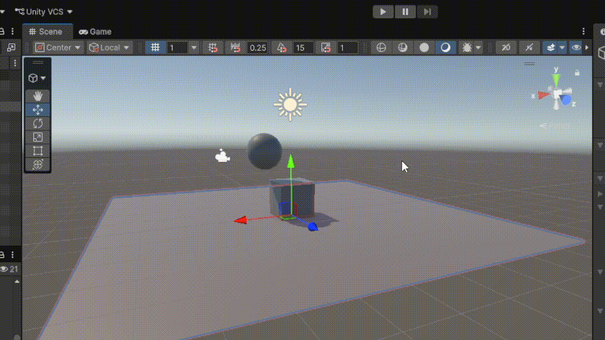

---

# Hoja 2. Física 3D mediante scripts C#

## Ejercicio 1: Movimiento de un personaje con Rigidbody
Crea un personaje,controla su desplazamiento con las teclas WASD o las flechas, el movimiento debe realizarse usando un Rigidbody, pero manteniendo el control total.

### Cómo se ha construido

Se crea una escena con un `Plane` como suelo y una `Capsule` como personaje. La cápsula se coloca en `(0, 1, 0)`, conserva su Collider y recibe un Rigidbody con `Use Gravity` activado. Se añade `Ej1Player.cs` y se ajusta `Speed` desde el Inspector, por ejemplo a `5`.

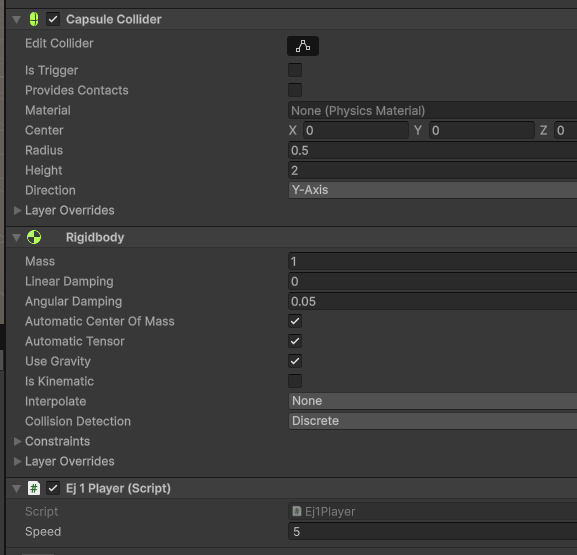

### Funcionamiento del script

`PlayerRigidbodyController` lee los ejes `Horizontal` y `Vertical` en `Update`, que permiten usar WASD y las flechas cuando están configurados los ejes. La dirección se limita a longitud máxima `1` para que el movimiento diagonal no sea más rápido. En `FixedUpdate`, el script modifica las componentes X y Z de `Rigidbody.linearVelocity` y conserva la componente vertical, de modo que la gravedad sigue controlando la caída.
También congela la rotación para evitar que los impactos tumben la cápsula y activa interpolación para suavizar la representación del movimiento. El personaje se controla en el plano horizontal mediante un Rigidbody, sin cambiar su Transform para simular movimiento.

### Ejecución

Al pulsar WASD o las flechas, la cápsula se desplaza horizontalmente y se mantiene apoyada en el suelo. La gravedad sigue funcionando en el eje vertical y el Collider evita que atraviese el plano.

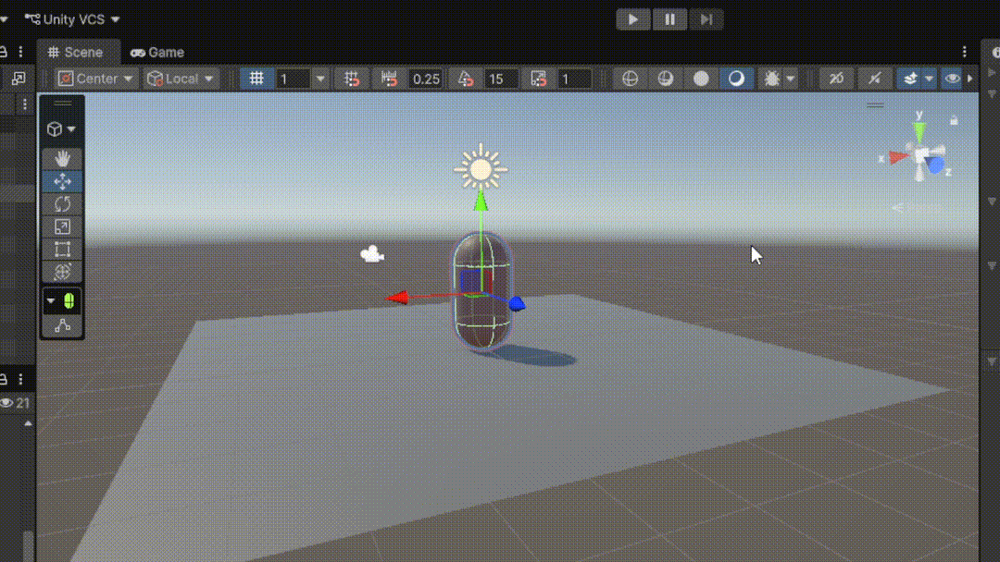

## Ejercicio 2: Detectar colisiones y cambiar colores
Crea varios cubos o esferas con Rigidbody dinámico. Muestra por consola el nombre del objeto con el que colisiona, y cámbiale su color al colisionar.

### Cómo se ha construido

Se crea una escena con varios cubos o esferas y un plano. Los objetos que deben caer reciben un Collider y un Rigidbody dinámico. Se añade `Ej2CollisionColor.cs` a cada objeto del que se quieren registrar los contactos y se deja `Is Trigger` desactivado para probar colisiones sólidas.

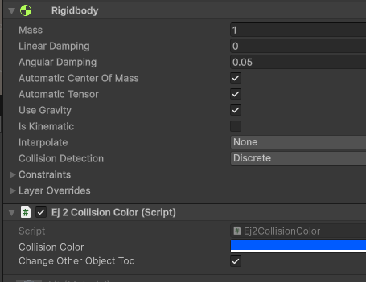

### Funcionamiento del script

El método `OnCollisionEnter(Collision collision)` se ejecuta cuando comienza una colisión sólida. El script consulta `collision.gameObject.name` para mostrar en la consola el nombre del otro objeto y cambia el color del Renderer del objeto que tiene el script. Si se activa `Change Other Object Too`, también cambia el color del objeto al que se ha tocado cuando este contiene un Renderer. El método auxiliar `SetColor` comprueba que el Renderer existe antes de cambiar su material.

### Ejecución

Cuando un objeto toca el plano u otro cuerpo, aparece un mensaje con el nombre del objeto en la consola y cambia el color del objeto que lleva el script. Si se activa la opción correspondiente, también cambia el color del otro objeto.

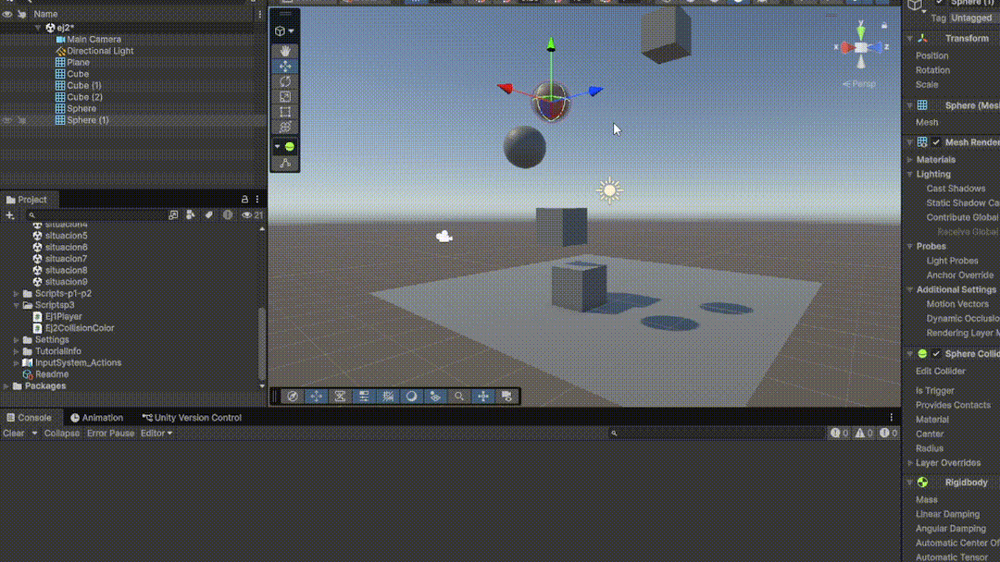
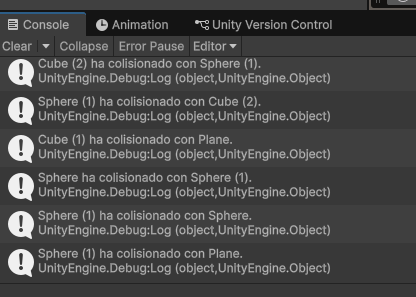

## Ejercicio 3: Zona Trigger con efecto visual y zona de daño
Crea una zona (por ejemplo, un cubo grande con Is Trigger = true). Al entrar, cambia el color del personaje o activa un efecto que cambie la luz. Al salir, revierte el cambio. Añade otra zona que aumente una variable daño.

### Cómo se ha construido

Se crea un cubo de mayor tamaño para representar una zona y se marca `Is Trigger` en su BoxCollider. Se añade `Ej3TriggerZone.cs`. Para el efecto visual se selecciona `Change Color`, se asigna el Renderer del personaje y se establece un color alternativo. En una segunda zona se selecciona `Add Damage` y se configura el incremento, por ejemplo `10`. Al objeto raíz del personaje se añade `Ej3PlayerStatus.cs`. Como alternativa al cambio de color, `Ej3TriggerZone` puede cambiar temporalmente la intensidad de una luz, y para ello se elige `Change Light Intensity` y se asigna una Light.

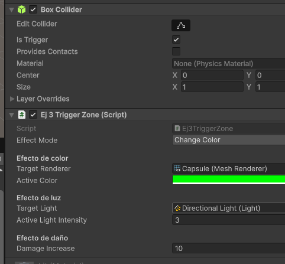
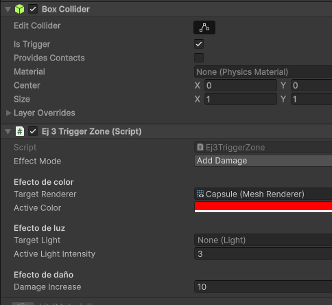

### Funcionamiento de los scripts

`Ej3TriggerZone` dispone de tres modos configurables. En `Awake` guarda el color original del Renderer o la intensidad original de la luz. En `OnTriggerEnter` comprueba si el objeto que entra dispone de `Ej3PlayerStatus`, si no lo tiene, ignora el contacto. Según el modo, cambia el color, aumenta la intensidad de la luz o llama a `PlayerStatus.AddDamage`. En `OnTriggerExit`, los efectos visuales restauran el valor original. El daño permanece acumulado. `PlayerStatus` conserva el contador de daño y ofrece `AddDamage(int amount)`. El método ignora valores no positivos, suma el incremento y escribe en la consola el total acumulado.

### Ejecución

Al entrar en la zona visual, el personaje cambia de color o se modifica la intensidad de la luz. Al salir, el efecto visual vuelve a su valor original. Al entrar en la zona de daño, aumenta el contador y el total queda reflejado en la consola.

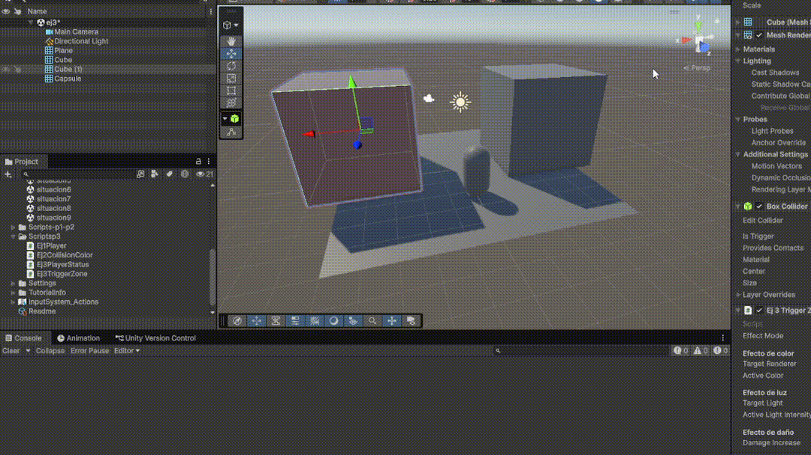

## Ejercicio 4: Capas, matriz de colisiones y recolectables
Crea tres tipos de objetos en capas distintas: jugador, enemigos, recolectables. Configura la Layer Collision Matrix (Project Settings > Physics). Haz que los enemigos solo colisionen con el jugador, y que los recolectables solo sean detectados por triggers.

### Cómo se ha construido

Desde **Edit -> Project Settings -> Tags and Layers** se crean las capas `Player`, `Enemies` y `Collectibles`, y se asignan a los objetos de la escena. En **Edit -> Project Settings -> Physics** se configura la `Layer Collision Matrix`. La configuración de referencia entre las tres capas es:

| Par de capas                    | Interacción                  | Motivo                                                               |
| ------------------------------- | ---------------------------- | -------------------------------------------------------------------- |
| `Player` – `Enemies`            | Activada                     | Permite la colisión entre jugador y enemigos.                        |
| `Player` – `Collectibles`       | Activada                     | Permite detectar al jugador entrando en el Trigger del recolectable. |
| `Enemies` – `Collectibles`      | Desactivada                  | Los enemigos no interactúan con recolectables.                       |
| `Enemies` – `Enemies`           | Desactivada                  | Los enemigos no colisionan entre sí.                                 |
| `Collectibles` – `Collectibles` | Desactivada                  | Los recolectables no interactúan entre ellos.                        |
| `Player` – `Player`             | Desactivada para esta prueba | Evita que los objetos de la capa jugador colisionen entre sí.        |

Cada recolectable recibe un Collider con `Is Trigger` activado y el script `Ej4CollectibleTrigger.cs`. El jugador debe tener Collider, Rigidbody y `Ej3PlayerStatus`. El personaje debe tener un Collider, un Rigidbody y el componente `Ej3PlayerStatus`, cuando entre en el área de recogida, el objeto desaparecerá porque se desactivará su GameObject.

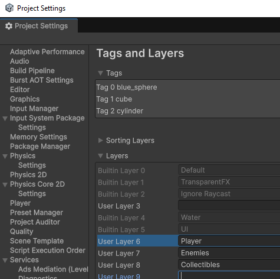
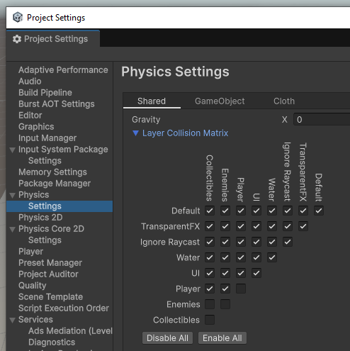
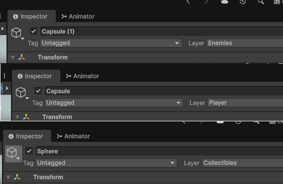

### Funcionamiento del script

`Ej4CollectibleTrigger` implementa `OnTriggerEnter`. Busca `Ej3PlayerStatus` en el objeto que entra, y si no lo encuentra, ignora la entrada. Si lo encuentra, escribe en la consola el nombre del jugador y el recolectable, y desactiva el GameObject del recolectable mediante `SetActive(false)`. La matriz de colisiones filtra qué pares de capas interactúan, mientras que `Is Trigger` permite detectar el solapamiento sin convertir el recolectable en un obstáculo sólido.

### Ejecución

Los enemigos colisionan con el jugador, pero no con otros enemigos ni con los recolectables según la matriz configurada. Cuando el jugador atraviesa un recolectable, aparece un mensaje en la consola y el objeto desaparece.

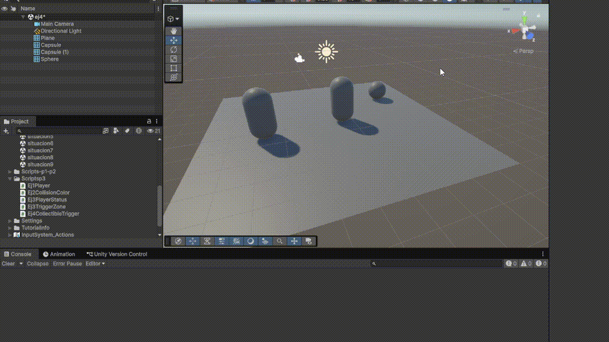

## Ejercicio 5: Physics Materials y lanzamiento con la tecla X
Crea una escena con distintos materiales físicos (resbaladizo, rugoso, rebote alto). Aplica distintos Physic Materials a objetos. Lanza los objetos con AddForce() al pulsar la tecla X y observa cómo cambian las reacciones.

### Cómo se ha construido

Se crean tres Physics Materials desde el panel Project:

| Material         | Dynamic Friction/Static Friction         | Bounciness | Bounce/Friction Combine          |
| ---------------- | ---------------------------------------: | ---------: | ---------------------------------|
| `PM_Resbaladizo` |                                  `0 / 0` |        `0` | Friction: Minimum                |
| `PM_Rugoso`      |                                `0.9 / 1` |        `0` | Friction: Maximum                |
| `PM_ReboteAlto`  |                              `0.3 / 0.3` |      `0.9` | Bounce: Maximum                  |

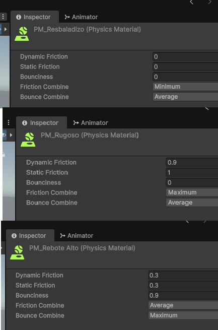

Los valores son una configuración inicial para hacer más visibles las diferencias, se asigna cada material al campo `Material` del Collider correspondiente. Se crean objetos con Collider y Rigidbody dinámico, y se añade `Ej5ForceOnX.cs`. Para observar las diferencias conviene disponer cada objeto sobre una superficie o zona con espacio de movimiento.

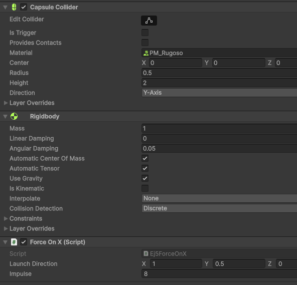
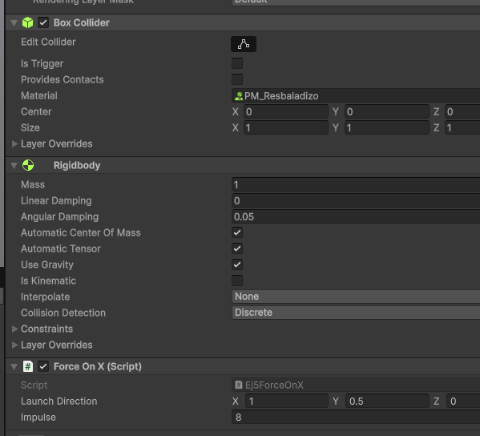
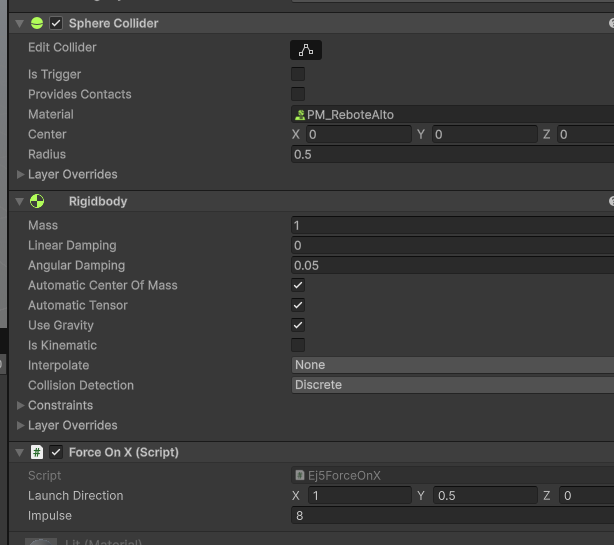

### Funcionamiento del script

`ForceOnX` detecta la pulsación de X en `Update` y almacena la petición. En `FixedUpdate` comprueba si el Rigidbody no es cinemático y si la dirección tiene longitud distinta de cero, entonces normaliza la dirección y llama a `AddForce` con `ForceMode.Impulse`. La dirección y la intensidad del impulso se configuran desde el Inspector. El impulso se solicita una vez por pulsación.

### Ejecución

Al pulsar X, los objetos reciben un impulso. Con el material resbaladizo se reduce la fricción y tiende a mantenerse el deslizamiento, con el rugoso, la fricción tiende a oponerse más al movimiento, con el material de rebote alto, el contacto produce un rebote continuo. El resultado también depende del material y del modo de combinación del otro Collider, la velocidad y el contacto.

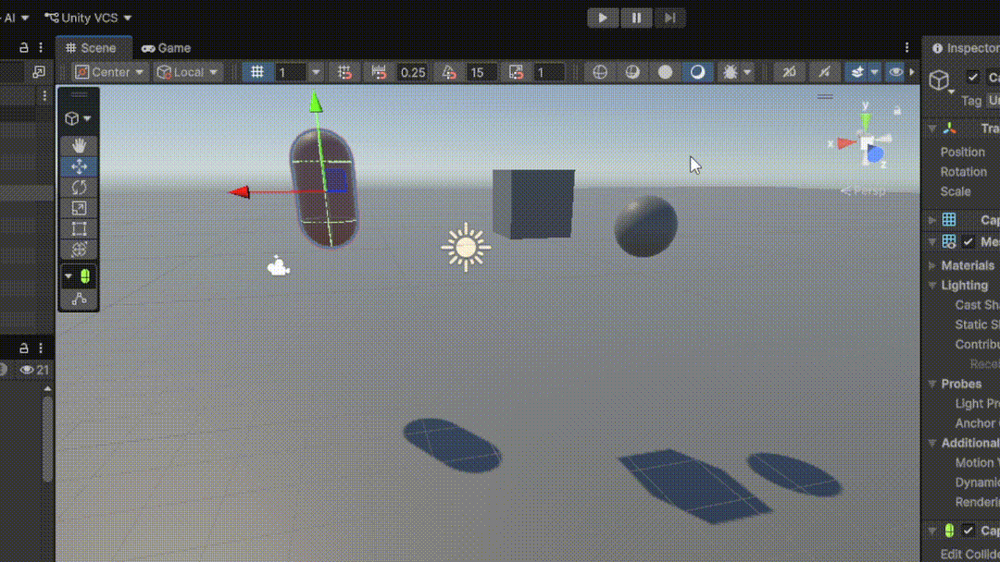

## Ejercicio 6: Esfera que se dirige al cilindro y cambia el material del cubo
En la escena debe haber 3 objetos que tengan Collider pero no Rigidbody. Un cubo, una esfera y un cilindro que deben estar alineados. Marcar el cilindro como objetivo a alcanzar por la esfera. El cubo debe hacer de obstáculo entre ambos. Implementar un script que haga que la esfera se dirija al cilindro, cuando la esfera alcance el cubo, este debe cambiar su material.

### Cómo se ha construido

Se crea una esfera, un cubo y un cilindro alineados sobre el eje X. Como disposición inicial se utilizan estas posiciones:

| Objeto   | Position       |
| -------- | -------------- |
| Sphere   | `(-3, 0.5, 0)` |
| Cube     | `(0, 0.5, 0)`  |
| Cylinder | `(3, 0.5, 0)`  |

El cubo se sitúa entre la esfera y el cilindro. Los tres objetos conservan su Collider correspondiente, pero **ninguno lleva Rigidbody**. Se crea un material para el cubo después del contacto y se añade `Ej6MoveSphere.cs` a la esfera. En el Inspector se asignan `Target` (Transform del cilindro), `Moving Sphere Collider` (SphereCollider de la esfera), `Obstacle Collider` (Collider del cubo), `Obstacle Renderer` (Renderer del cubo) y `Obstacle Hit Material` (material que se aplicará). Se puede cambiar la velocidad, en este caso será `Speed = 2`.

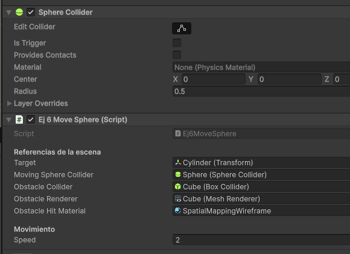

### Funcionamiento del script

`Ej6MoveSphere` mueve la esfera gradualmente hacia el Transform objetivo mediante `Vector3.MoveTowards`, escalando el movimiento con `Time.deltaTime`. Como ningún objeto tiene Rigidbody, no se utiliza `OnCollisionEnter`. En cada actualización se llama a `Physics.ComputePenetration`, que comprueba si el SphereCollider y el Collider del cubo se solapan en las posiciones indicadas. Cuando detecta el solapamiento, el script asigna el material nuevo al Renderer del cubo, marca `obstacleChanged` para evitar repetir la acción y escribe un mensaje en la consola. Esta comprobación detecta el solapamiento, que no simula una reacción física ni hace que el cubo bloquee la esfera.

### Ejecución

La esfera avanza hacia el cilindro y atraviesa el área del cubo porque no existe una simulación de cuerpos rígidos para estos objetos. Cuando su Collider se solapa con el del cubo, el cubo cambia al material asignado y se registra el contacto en la consola, y después la esfera continúa hacia el objetivo.

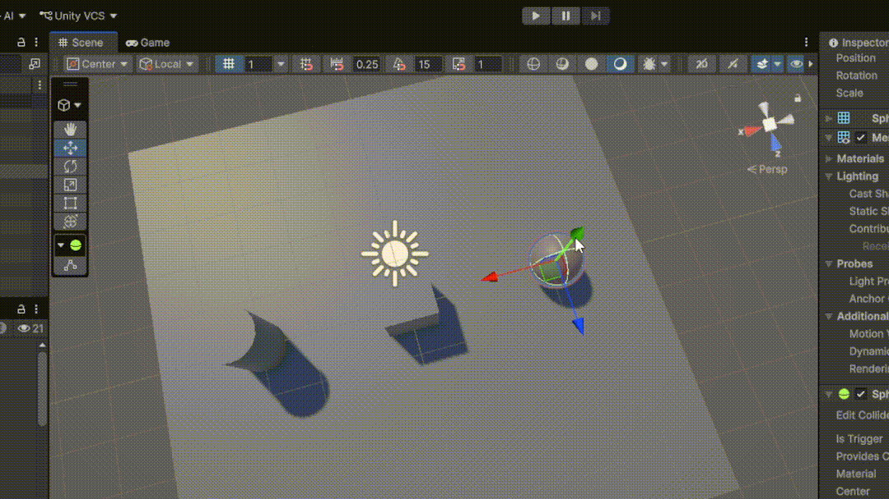
